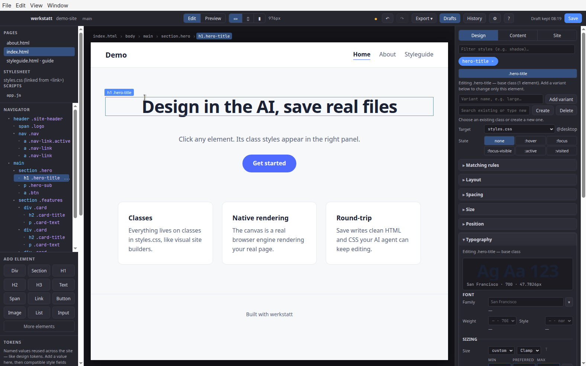

# werkstatt

A local visual editor for hand-written HTML and CSS. Click an element, change its class rules, and save the same files.



You built a site with an AI agent. Now come the small, personal decisions: the
accent color, a margin, whether that heading reads better at 22, 23, or 24px.

An agent is a clumsy tool for those. It can misread the request and change
something else, regenerate more than you asked for, or make you describe a look
in words and wait to see it. For "is this better?" you want to change the value
and watch the page.

werkstatt is a local, visual editor for the site the agent wrote. It works on
the real, plain HTML/CSS/JS files (no build step, no framework): open the
folder, click an element, change its class rules in the panel, and see it live.
Save writes the same files back to disk, so the next agent run builds on your
changes instead of undoing them. HTML stays the source of truth, CSS lives in
the linked stylesheet, and JavaScript is progressive enhancement only.

- Class-based editing: a class/token/design-element system of the kind many
  users of visual site builders already know.
- Fidelity first: authored CSS (nesting, `@layer`/`@container`, complex
  selectors) survives open → edit → save.
- Designed for sites written by an AI agent and tweaked by hand between runs.

## Using it with your AI agent

Give your agent the prompt in [`AGENT_SITE_PROMPT.md`](AGENT_SITE_PROMPT.md) when
you ask it to build the site. That prompt is the contract that keeps the output
openable and editable here: classes instead of inline styles, one `styles.css`,
`:root` brand tokens, and interactive states expressed as classes.

Then use werkstatt for the visual tweaks. JavaScript is only previewed — Edit
mode disables it, Preview runs it, and the panel does not edit behavior. To
change scripts, go back to your agent; it reads any `AGENT_HANDOFF.md` in the
site so it preserves the edits you made by hand.

## Requirements

- Node.js 18+
- macOS, Windows, or Linux

## Download

macOS installers are attached to [GitHub Releases](https://github.com/svevol/werkstatt/releases)
when a `v*` tag is pushed (unsigned Intel and Apple silicon `.dmg` files).
There is no Windows or Linux installer yet.

## Quick start

```bash
git clone https://github.com/svevol/werkstatt.git
cd werkstatt
npm install
npm start
```

Use **Open site folder** to load a project, or **Try demo site** to open the
bundled `demo-site/`. `starter-site/` is a minimal template and `showcase-site/`
is a longer example with the interactive components the editor knows about.

## Test

```bash
npm test        # unit tests
npm run smoke   # end-to-end smoke run (Electron)
```

## Layout

```
src/            Electron main process, preload, and renderer
  main.js       app entry and file/IPC layer
  preload.js    context bridge
  renderer/js/  editor UI (ES modules)
demo-site/      bundled example site
starter-site/   minimal starting template
showcase-site/  product showcase, tutorials, and in-editor lab
test/           unit tests (node --test)
AGENT_SITE_PROMPT.md   contract for AI-generated sites
AGENTS.md              instructions for contributors/agents
CONTRIBUTING.md        contribution terms and process
TASKS.md               development log (internal; long)
```

## Contributing

Fork, branch, and open a pull request against `main`. By submitting you agree to
the inbound contribution grant in [CONTRIBUTING.md](CONTRIBUTING.md); the
maintainer decides what is merged.

## License

**TL;DR** — the plain-language version. The full text in
[LICENSE.txt](LICENSE.txt) is what legally applies.

- **Free to use by anyone**, including companies: build sites, do paid client
  work, use it internally — no fee.
- **You may not sell or redistribute werkstatt itself** (or a modified version):
  no repackaging, embedding, white-labeling, or hosted/managed service.
- **You may read, study, and modify the source** and send improvements, but the
  maintainer decides what is merged.
- **Paid add-ons** — hosting, login/SSO, and collaborative editing — are
  separate and available on request.

Source-available under the [werkstatt Source-Available No-Resale
License](LICENSE.txt), not an OSI open-source license. Questions or commercial
licensing: [svetlana@shepelin.me](mailto:svetlana@shepelin.me).
